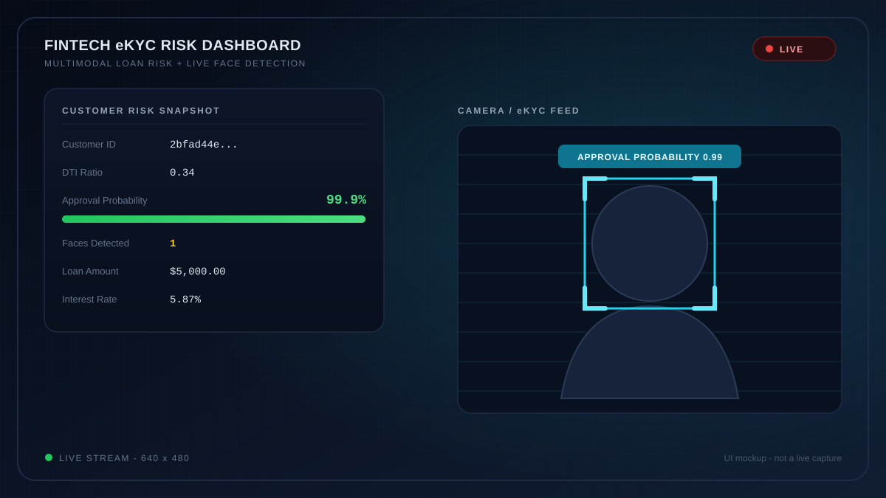

<div align="center">

# Fintech eKYC Risk Dashboard

**Loan risk scoring meets live face detection - in one real-time dashboard.**

[](https://www.python.org/)
[](https://scikit-learn.org/)
[](https://opencv.org/)
[](LICENSE)
[](#requirements)

[Overview](#overview) | [Quick Start](#quick-start) | [How It Works](#how-it-works) | [Dataset](#dataset) | [Roadmap](#roadmap)

</div>



> [!NOTE]
> This is an educational demo, not a production credit-scoring engine, a real identity-verification system, or financial advice.

## Overview

**Fintech eKYC Risk Dashboard** is a compact end-to-end demo that connects a machine-learning credit-risk model to a live webcam feed. It trains a scikit-learn pipeline on customer and loan data, estimates the probability of loan approval, and overlays that score on a real-time OpenCV dashboard alongside detected faces.

The goal is to show how tabular risk scoring and computer vision can be combined in a single, understandable prototype - not to provide a deployable lending decision system.

| At a glance | Details |
| :-- | :-- |
| **Task** | Multiclass loan status prediction |
| **Model** | `GradientBoostingClassifier` |
| **Vision** | Haar-cascade face detection |
| **Interface** | OpenCV live desktop window |
| **Dataset** | 1,000 rows, 34 columns |
| **Stack** | Python, scikit-learn, OpenCV, pandas, NumPy |

## Highlights

| Feature | What it does |
| :-- | :-- |
| **End-to-end ML pipeline** | `Pipeline` + `ColumnTransformer` handle imputation, encoding, training, and inference in one object. |
| **Credit-risk feature engineering** | Derives debt-to-income ratio, liquidity buffer, net cash flow, average income, and employment tenure. |
| **Live face detection** | Detects frontal faces in each webcam frame and draws bounding boxes with the approval score. |
| **One-key capture** | Press `s` to save the annotated frame and cropped face images. |
| **Robust encoding** | `OneHotEncoder(handle_unknown="ignore")` keeps inference stable when new categories appear. |

## Requirements

- Python 3.10+ (tested on 3.14)
- A webcam
- `opencv-python` 4.x, `pandas`, `numpy`, and `scikit-learn` (see `requirements.txt`)

## Quick Start

```bash
# 1. Clone into a normal folder name
git clone https://github.com/janidu20050306/-multimodal-fintech-ekyc.git fintech-ekyc-risk-dashboard
cd fintech-ekyc-risk-dashboard

# 2. Create a virtual environment
python -m venv .venv
.venv\Scripts\activate          # Windows
# source .venv/bin/activate     # macOS / Linux

# 3. Install dependencies
pip install -r requirements.txt

# 4. Run the dashboard
python main.py
```

> [!IMPORTANT]
> Use `opencv-python` 4.x. OpenCV 5.x removed `cv2.CascadeClassifier` and the bundled Haar cascades, so `requirements.txt` intentionally pins OpenCV below 5.

### Controls

| Key | Action |
| :--: | :-- |
| `s` | Save the annotated frame and any detected face crops |
| `q` | Quit the live stream |

Generated files are named `ekyc_output_frame_<n>.png` and `face_<n>.png`.

Example terminal output:

```text
Predicted status: approved | Approval probability: 99.87%
Starting live stream... Press 'q' to quit or 's' to save annotated frame output.
```

## How It Works

1. Load `sampleDataset.csv`.
2. Parse `Customer Profile.employment_history` and derive average income and years of employment.
3. Engineer risk features:
   - `dti_ratio = loan_amount / (monthly_income * 12)`
   - `liquidity_buffer = balance / loan_amount`
   - `net_cash_flow = deposits - withdrawals`
4. Impute numeric features with the mean and one-hot encode categorical features.
5. Train a `GradientBoostingClassifier` on `Loan Application Summary.loan_status`.
6. Score a sample customer, then overlay the approval probability on the live camera feed.

```mermaid
flowchart TD
    A[sampleDataset.csv] --> B[Feature engineering]
    B --> C[Impute + one-hot encode]
    C --> D[GradientBoostingClassifier]
    D --> E[Approval probability]
    W[Webcam frame] --> F[Haar-cascade face detection]
    E --> G[Live dashboard overlay]
    F --> G
    G --> H[Display and optional capture]

    classDef data fill:#0f172a,stroke:#38bdf8,color:#e2e8f0
    classDef model fill:#1e1b4b,stroke:#818cf8,color:#e2e8f0
    classDef output fill:#052e16,stroke:#22c55e,color:#dcfce7
    class A,W data
    class B,C,D,E,F model
    class G,H output
```



### Model Inputs

| Type | Features |
| :-- | :-- |
| Numeric | balance, income level, interest rate, loan amount, DTI ratio, liquidity buffer, net cash flow |
| Categorical | occupation, loan purpose |

The approval probability is looked up by class name (`approved`), not by a hard-coded class index.

## Dataset

`sampleDataset.csv` contains 1,000 rows and 34 columns covering customer profiles, account activity, loan applications, and time-series data.

| Loan status | Rows |
| :-- | --: |
| approved | 448 |
| pending | 284 |
| rejected | 268 |

The CSV is about 22 MB and is included in this repository. If you reuse or redistribute it, confirm that the data is synthetic or properly anonymized, and consider Git LFS or a smaller sample if needed.

## Configuration

| Setting | Location |
| :-- | :-- |
| Customer to score | `sample_idx` in `main.py` |
| Camera device | `cv2.VideoCapture(0)` in `main.py` |
| Dependencies | `requirements.txt` |

## Project Structure

```text
fintech-ekyc-risk-dashboard/
|-- docs/
|   `-- preview.svg
|-- main.py
|-- sampleDataset.csv
|-- requirements.txt
|-- LICENSE
|-- .gitignore
`-- README.md
```

## Limitations

> [!WARNING]
> The model is trained and scored on the same rows, with no train/test split, calibration, or fairness evaluation. The displayed probability is illustrative only.

- Haar cascades detect frontal faces only and are sensitive to lighting, pose, and occlusion. There is no face recognition, liveness detection, or identity matching.
- `pending` is treated as a separate class, so the demo does not model a binary approve/reject boundary.
- The sample dataset includes customer and account fields that may be sensitive. Review and anonymize it before redistributing or reusing it in another project.

## Roadmap

- [x] End-to-end training and inference pipeline
- [x] Live webcam overlay and frame capture
- [ ] Train/test split with ROC-AUC, precision/recall, and calibration metrics
- [ ] Replace Haar cascades with YuNet or MediaPipe
- [ ] Add liveness detection for a more realistic eKYC flow
- [ ] Move configuration into CLI arguments or a config file
- [ ] Add automated tests for feature engineering and inference

## Contributing

Issues and pull requests are welcome. Fork the repository, create a feature branch, and open a PR with a short description of the change.

## License

Released under the [MIT License](LICENSE).

<div align="center">

Built by [Janidu Induwara](https://github.com/janidu20050306)

If this demo is useful, consider giving the repository a star.

</div>
